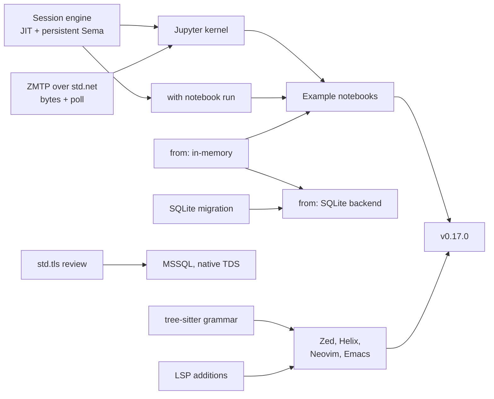

# v0.17.0 lifestyle enablement release: proposal

Nov 27, 2026 · @Eric

## Summary

v0.17.0 makes With a language people live in, not only one they compile with: a Jupyter kernel, a REPL, a notebook, fast one-liners, all eight major editors, first-party packages for games, desktop tools and SQL Server, and the next standard-library corpora.

The release rests on one new piece of engineering: a **session engine**, a compiler that stays alive between inputs and runs each new input with an in-process LLVM JIT, keeping every earlier binding, type and function. The Jupyter kernel, `with repl`, `with notebook` and the one-liners are four front ends over that one engine, and the language server shares its semantic analysis. Build it once, well, and four features fall out.

The kernel gets the most attention because it is where With meets the largest new audience. Jupyter is where data scientists, ML engineers and researchers work, and Python is the reference point With chose in its first blog post. A With notebook that pulls in a C library with one command, keeps ownership checked across cells, and shows a query result as a table is something no systems language offers today.

Everything here is measured against the commit `94195e2` (2026-11-27). Where this document says "today", it means that tree.

## Scope, non-goals and what done means

The release has four tracks that can run in parallel once the session engine exists.

| Track | Items |
| --- | --- |
| Interactive | Session engine, Jupyter kernel, `with repl`, `with notebook`, one-liners |
| Editors | A complete LSP server; first-party integrations for VS Code, JetBrains, Visual Studio, Vim/Neovim, Zed, Emacs (Eglot), Helix, Sublime Text |
| Packages | Game (PC, Mac, Linux, Steam Deck; consoles as a stretch), desktop application, MSSQL |
| Standard library | Math, jq, SQLite, `from` query expressions |

**Non-goals for v0.17:**

- ipywidgets and other Jupyter `comm` traffic. The kernel answers `comm_info_request` truthfully with no comms.
- A With-native UI framework. The With UI proposal stays on its own track; the desktop package does not pre-empt it.
- Console platform support as a shipped target. The goal is that nothing in With blocks a licensed studio (see the packages section).
- An out-of-process executor for notebooks. The design keeps the door open; v0.17 runs cells in the kernel process.

**What done means, for every item:**

1. A `with uat` scenario that exercises it the way a user would, green on every platform the item claims.
2. A page in the user guide, written for someone who has never seen With.
3. No silent fallbacks: a feature that cannot do what was asked says so and names why.
4. For the editors and the kernel, a published entry where developers look for it (a marketplace, a registry, a kernelspec install command), not only a directory in the repo.

## One engine under four front ends

The session engine replaces today's `with repl`, which recompiles and re-runs every earlier statement on each turn.

**Today.** `run_repl_unit` (`src/main.with`) builds one program from every import, declaration and statement entered so far plus the new line, links it to a binary, runs it, and prints only the output after a sentinel string. So each turn re-executes all earlier statements, and their side effects repeat: a file written again, a request sent again, a window opened again. Turn latency grows with the session, and nothing expensive to build (a loaded model, an open database) can survive between turns.

&#91;embedded content: session engine · four front ends and the LSP over one analysis\]

The four front ends differ only in how input arrives and output is shown; the engine underneath is shared, and the language server reuses its analysis.

**The engine, in three parts:**

1. **A persistent compilation session.** One compilation lives for the whole session. Each input is parsed and checked against everything already accepted. Declarations (`fn`, `type`, `trait`, `impl`, `const`) join the session module. Top-level statements become one synthesized cell function, run once. Top-level `let` and `var` become session globals assigned in statement order, the rule #2951 gave a script's top level, so a notebook means exactly what the same lines mean in a script.
2. **An in-process JIT.** The compiler already carries LLVM statically linked (D81). The engine adds LLVM's ORC JIT: each cell's code is added to the running session, its references resolve to earlier cells' functions and globals, and its cell function is called once. Nothing re-runs, and no linker or temporary binary is involved.
3. **Shared analysis.** Completion, hover and signature help run against the session's state plus the text being edited, so completing `xs.` in cell 5 knows the `xs` bound in cell 2. The LSP server is the same analysis over editor files.

**Rules every front end inherits:**

- **Cells run on the process main thread;** protocol and terminal I/O run on other threads. macOS only lets the main thread create windows, so this is what lets a raylib or SDL window open from a notebook cell.
- **A panic in a cell ends that cell, not the session.** The panic unwinds the cell function, drops run, and earlier state stays.
- **Nothing is silently replayed.** If state is lost (a crash, a restart), the front end says so and offers to re-run cells explicitly.

**What it costs, from the tree:**

- There is no JIT today. New code: an ORC binding in the LLVM bridge, symbol resolution for the runtime objects and for libraries fetched by `with get`, and a session driver (`src/Session.with`, proposed).
- `c_import`, the C migrator and the clang bridge keep process-global session state behind a lock (`src/compiler/Frontend.with:418`). A notebook that imports headers in cell 3 and again in cell 9 needs that state behind a session handle. This is the largest refactor in the release.
- The session engine is the first caller that keeps a compilation alive and feeds it more source, so any hidden global in the compiler becomes a bug. A gate test should run the same cells in two sessions in one process and compare the results.

## Jupyter kernel: protocol, transport and installation

`with kernel` speaks Jupyter messaging protocol 5.5 over a ZeroMQ wire implementation written in With, so a With notebook needs nothing installed beyond the `with` binary and a Jupyter front end.

**The protocol.** A kernel serves five channels ([messaging spec](https://jupyter-client.readthedocs.io/en/latest/messaging.html)):

| Channel | Socket | Carries |
| --- | --- | --- |
| Shell | ROUTER | Execute, complete, inspect, is-complete, history, kernel info |
| Control | ROUTER | Interrupt, shutdown, restart, kernel info; never queued behind a running cell |
| IOPub | XPUB (PUB before 5.5) | Status, stream output, display data, results, errors |
| Stdin | ROUTER | `input()` requests to the front end |
| Heartbeat | REP | Echo, so the front end knows the kernel is alive |

Each message is a multipart frame sequence: routing identities, the `<IDS|MSG>` delimiter, an HMAC-SHA256 hex signature over the header, parent header, metadata and content, those four JSON dicts, then optional binary buffers.

**Transport: implement ZMTP in With, don't link libzmq.** libzmq is C++, so `with migrate` cannot bring it in, and linking it would make the kernel the first part of the toolchain to need a C++ runtime. The kernel needs only a small part of ZeroMQ: the ZMTP 3 greeting, the NULL security handshake (Jupyter's security is the per-message HMAC plus binding to localhost), framing, and ROUTER, XPUB and REP behavior over TCP. That is a contained module (`std.internal.zmtp`, proposed) with a test against a real libzmq peer in a battery lane.

**Threads.** Heartbeat runs on its own OS thread and only echoes. Shell, control, stdin and IOPub run on an I/O thread. Cells run on the main thread (previous section). So an interrupt or a shutdown is answered even while a cell runs for an hour.

**Security.** Every incoming message's signature is checked with `std.crypto.hmac` against the connection file's key, compared in constant time; a bad or missing signature is dropped and logged, never executed. The spec allows an empty key to disable signing; the kernel accepts it but prints a warning at startup. Sockets bind only to the address in the connection file, which Jupyter sets to `127.0.0.1`.

**Gaps in the standard library this exposes.** `std.net` today is descriptor-based, and `recv` returns a `str`. ZMTP frames are binary, and the I/O thread must wait on several sockets at once, so the kernel needs byte-slice send and receive and a poll or readiness primitive. Both belong in `std.net`, not in the kernel.

**`kernel_info_reply`.** `implementation: "with"`, the compiler version, `protocol_version: "5.5"`, and `language_info` with name `with`, the language version, mimetype `text/x-with`, file extension `.with` (D228), and `pygments_lexer: "with"`. `help_links` point at the spec and the guide. `supported_features` is empty in v0.17; `debugger` comes with debugging support later.

**Installation, with no Python.** A kernelspec is a directory with a `kernel.json` and logos in a known place, so `with kernel install` writes it directly:

- Linux `~/.local/share/jupyter/kernels/with/`, macOS `~/Library/Jupyter/kernels/with/`, Windows `%APPDATA%\jupyter\kernels\with\`; `--sys-prefix` and `--prefix` for environments.
- `argv` is the absolute path of the installing `with`, then `kernel -f {connection_file}`. `with kernel install --check` reports a stale path after `with` moves or upgrades.
- `interrupt_mode: "message"` on every platform. Interrupts then arrive on the control channel as `interrupt_request` ([kernel docs](https://jupyter-client.readthedocs.io/en/latest/kernels.html)), which works the same on Windows, where SIGINT delivery to a kernel is unreliable.
- `with doctor` lists installed With kernelspecs and their paths.

The 5.6 startup handshake (a registration file instead of a connection file) is not needed for v0.17 and can follow once front ends adopt it.

## Jupyter kernel: execution model

A notebook is a script whose top level arrives in pieces and may be re-run out of order; the execution model keeps With's guarantees (checked ownership, no leaks, no silent change of meaning) across that.

**A cell.** Declarations join the session module. Statements become the cell function, run once. Top-level `let` and `var` become session globals. If the cell ends in an expression whose type is not `Unit`, its value is displayed as the cell's result, as IPython does, because With already treats a block's tail expression as its value. A cell that fails to compile takes no effect at all: none of its declarations or bindings are added.

**Order is execution order.** Session state reflects cells in the order they ran, as Jupyter's execution count shows, not their order on the page. `with notebook run` (later section) executes top to bottom for reproducible output.

**Ownership persists across cells.** Move state is session state, and diagnostics name the cell by its execution count:

```
// [1]
let xs = [1, 2, 3]
// [2]
archive(xs)
// [3]
print(total(xs))   // error: use of moved value `xs` (moved in cell [2], line 1)
```

This is the demonstration no other notebook can give: Python would print the list, and in a C++ notebook a moved-from vector is silently empty.

**Views end with their cell.** A view is ephemeral and cannot be a global. A top-level binding whose type is a view is local to its cell; using it in a later cell is an error that says so: "`v` is a view and ended with cell \[4\]; derive it again in this cell." The same rule should hold for a script's top level, which is one cell (decision 2 below).

**Re-running a cell rebinds.** The old value of each global the cell binds is dropped first, so `Drop` runs and nothing leaks, then the new value is assigned. This is not shadowing: the old binding no longer exists, in the spirit of §29.8's consuming rebind.

**Redefining a function.** Same signature: the new body replaces the old everywhere, including calls from functions defined in earlier cells (the JIT calls through a redirectable stub). Different signature: it is a new function; earlier functions keep calling the old one, and the kernel says which: "`report` (cell \[1\]) still calls the earlier `f(i32)`; re-run cell \[1\] to use the new one." Nothing is re-run silently.

**Redefining a type.** Globals holding values of the earlier type are dropped at the redefinition, with the earlier type's `Drop`, and the kernel lists them in the cell's output. Code compiled against the earlier type keeps working on its own values; it cannot receive the new type, because the checker sees them as different types.

**Async at the top level.** A cell may `.await` at its top level, as IPython allows. The cell function becomes async and the engine runs the fiber scheduler until it finishes. A task stored in a global keeps its state between cells, advances only while a later cell runs, and can be awaited later.

**Interrupts.** An `interrupt_request` sets the runtime's interrupt flag, which already exists (`with_interrupt_requested`, `rt/compat_runtime.with`). Code compiled for a session gets an interrupt check at loop back-edges and function entries, a load and a branch, which panics with `interrupted`; the cell unwinds, drops run, and the session survives. Precompiled standard-library bundles and C code are not checked, so interrupt latency is bounded by the longest such call, and the kernel reports when a cell does not stop within a grace period so the front end can offer a restart.

**Output and input.** The kernel points file descriptors 1 and 2 at pipes drained by the I/O thread and forwards them as `stream` messages, so a C library's `printf` appears in the notebook like With's `print`. `read_line()` in a cell sends an `input_request` on the stdin channel when the front end allows input and fails clearly when it does not.

**Restart** is a new process with an empty session, which Jupyter already manages.

## Jupyter kernel: output, editing help, C libraries, front ends and testing

Every value displays with no effort, and a library can make its values display richly, because the compiler already generates `Debug` for every type and comptime can read a type's fields.

**Display.**

- **Plain text for everything.** A cell's result displays as `text/plain` through `Debug` (`:?`), which the compiler generates for every type and which is recursive and quoted (§11.9, D61).
- **Rich output by trait.** A type implements a std trait (proposed name `Show`) returning a MIME bundle: `text/html`, `image/png`, `image/svg+xml`, `application/json`, `text/markdown`. The kernel sends the whole bundle and the front end picks.
- **Tables for free.** A list of structs displays as an HTML table whose columns come from `T.fields()` at compile time (§17.2), with the first rows shown and a count of the rest. A `from` query's result is therefore a table in a notebook without any library code.
- **Images.** `std.png` already exists; an image type implementing `Show` displays inline.
- **`display(x)` mid-cell**, and `display(x, id: "progress")` with a later update of the same id, for progress output.
- **Errors.** A compile error is an `error` reply whose traceback is With's diagnostics with positions as `cell [3], line 2`. A panic shows its message and the frames inside session code.

**Editing help, shared with the LSP.**

- `complete_request` and `inspect_request` run the LSP's completion and hover against session state plus the cell's text.
- `is_complete_request` decides whether a console front end should wait for more lines: a trailing `:` or an open bracket is `incomplete` with an indent hint of four spaces, an unterminated string is `incomplete`, a parse error is `invalid`. Today's `repl_unclosed_delims` (`src/main.with`) is a byte scanner; this should come from the parser instead.
- `history_request` reads the session history file the REPL also uses.

**C libraries in a notebook.** This is With's differentiator and should be the first thing the tour notebook shows.

- **Project discovery.** Jupyter starts a kernel in the notebook's directory. The kernel looks upward for `with.toml` and, if found, uses that project's dependencies, lockfile and facades.
- **Kernel commands.** A line that starts a cell with `%` cannot be With code, so a small fixed set of commands is unambiguous: `%get c.raylib`, `%remove`, `%deps`, `%reset`, `%time`, and `%who` (session globals, their types and whether they have been moved). `%get` with no project creates `with.toml` beside the notebook, so its dependencies are visible and reproducible. The REPL accepts the same set; users cannot add commands in v0.17.
- **Linking.** `use c_import("raylib.h")` in a cell works as in a program; the JIT resolves the library's symbols from the static archive or shared library `with get` fetched.
- **Windows from cells.** Because cells run on the main thread, a raylib or SDL window opens on macOS. Between cells nothing pumps its events, so a long-lived interactive window belongs in one cell's loop; the notebook-friendly pattern is drawing frames and displaying them inline, which the raylib spiral UAT already does with `LoadImageFromScreen`.
- **Crashes.** A segfault in C code ends the kernel process, and Jupyter reports it and restarts. v0.17 accepts that. LLVM's JIT can run code in a separate executor process, so a later release can keep compile state across a crash and say which cell crashed.

**Front ends.**

| Front end | What works with any kernelspec | Work in v0.17 |
| --- | --- | --- |
| JupyterLab and Notebook 7 | Execution, output, completion | Syntax highlighting needs a CodeMirror 6 language package, shipped as a prebuilt JupyterLab extension |
| VS Code with the Jupyter extension | Execution, output, completion | Register the With grammar the existing extension ships for notebook cells |
| JetBrains IDEs | Their Jupyter support; which editions run non-Python kernels needs checking | Test and document |
| nbconvert and static HTML | Rendering with Pygments | Upstream a Pygments lexer for With |
| `with notebook` | Built in | Next section |

**Testing.**

- **Gate:** a Jupyter protocol client written in With drives `with kernel` over real sockets through `with uat`: kernel info, execute with streams, display, errors, interrupt mid-loop, is-complete, completion, shutdown. No Python in the gate.
- **Battery:** the standard conformance suite `jupyter_kernel_test` and real JupyterLab executing the example notebooks. These need Python, so they are a battery lane, not the gate.
- **Example notebooks as acceptance,** executed headless with `with notebook run` and their outputs compared: a tour of With, ownership across cells, SQLite with `from` displayed as tables, a raylib frame drawn inline, and text processing with regex and zlib.

## with repl

`with repl` becomes a thin terminal front end over the session engine: each entry compiles and runs once, so a turn costs the same in minute one and hour three.

**What changes from today.** The replay loop in `run_repl_unit` goes away, and with it the repeated side effects and the growing turn time. The existing heuristics (`repl_line_is_decl`, `repl_unclosed_delims`) are replaced by the parser: the engine classifies an entry as declaration or statement, and multi-line input uses the same is-complete function as the kernel.

**Line editing.** The REPL needs history, completion, multi-line editing and highlighting on macOS, Linux and Windows. linenoise is on the stdlib migration list but has no Windows console support. isocline (C, MIT licensed) covers all three platforms with completion and highlighting callbacks, and fits the corpus pipeline with per-target migration. The alternative is a line editor written in With. Either way it should be a library other With programs can use, not REPL-internal code (decision 4 below).

**Behavior.**

- Each result prints through `Debug`; a value of a type implementing `Show` prints its `text/plain` form.
- The same `%` commands as the kernel, plus `%type expr` (the type, without evaluating) and `%help`.
- History persists in the user's With data directory; completion comes from the engine, so it knows session globals and the project's modules.
- Inside a project, the REPL loads its dependencies and modules exactly as the kernel does.

**From a REPL to a program.**

- `with repl tool.with` runs the script, then continues in a session that holds its globals, as `python -i` does.
- `%save session.with` writes the accepted inputs, in order and without failed ones, as a script that runs to the same state. A session becomes a file in one step.

**Done means** a UAT scenario that drives the REPL through a pseudo-terminal on every platform: a multi-line function, a move error naming its earlier entry, a `%get` and a C call, an interrupt during a loop, and `%save` followed by `with run` of the saved file. Startup and per-entry latency are measured once the engine runs, and the release sets and gates on targets from those measurements.

## with notebook

`with notebook` is the no-Python path to notebooks: the same `.ipynb` files Jupyter uses, run headless or edited in a browser, served by the `with` binary over the session engine directly.

It has three parts, in the order they should land:

1. **`with notebook run nb.ipynb`** executes every code cell top to bottom, writes outputs into the file (or `-o out.ipynb`), and exits non-zero on the first error unless `--continue` is given. This is what CI and the example-notebook tests need, so it comes first. It talks to the engine in process, with no sockets.
2. **Notebooks as text.** A `.with` file whose cells are marked with `// %%` lines is a notebook that is also an ordinary script: the markers are comments, so `with run` runs it unchanged. `with notebook convert` turns `.with` into `.ipynb` and back, and the VS Code extension offers "run cell" on the markers. Notebooks then diff and review as text in git, which `.ipynb` files famously do not.
3. **`with notebook [nb.ipynb]`** opens a local notebook in the browser: code and Markdown cells; run, run all, interrupt, restart; rich output; completion from the engine; save. The front end is static HTML, CSS and JavaScript embedded in the binary (CodeMirror 6 for editing), and it talks to the engine over a WebSocket using message shapes copied from Jupyter's, so nothing new is invented.

**Security for the local server.** A local server that executes code is a classic attack target. It binds to `127.0.0.1` only, requires a random token in the URL it prints, checks the `Origin` and `Host` headers to defeat cross-site requests and DNS rebinding, and refuses non-local connections unless told otherwise. Jupyter Server does the same for the same reasons.

**File format.** nbformat 4.5, with `metadata.kernelspec.name` set to `with` and `language_info` as the kernel reports it, so a notebook made by `with notebook` opens in JupyterLab, VS Code or GitHub, and one made there opens here.

**Out of scope for v0.17:** extensions, widgets, multiple users, real-time collaboration.

**What it needs from the standard library.** A small HTTP server and WebSockets. `std.http` exists; whether it serves as well as fetches should be checked before this is scheduled. If it does not, a minimal server belongs in `std.http`, not inside the notebook command.

## One-liners

One-liners already exist (`-e`, `-n`, `-p`, with code before and after the loop, §18.5b); v0.17 makes them fast enough to use in a shell loop and complete enough to replace awk, sed and jq for daily work.

**Speed.** A one-liner today is compiled, linked and executed like a program. Two changes:

- Run it through the session engine's JIT: no link step and no temporary binary.
- Cache compiled one-liners by content, the way the build already keys work on what it is made from (D50), so `for f in *.log; do with -n '...' "$f"; done` compiles once.

Measure today's latency for `with -e 'print(1)'` and a typical `-n` filter first, then set the release's target from that measurement.

**Parity with Perl and awk.** Each needs spec words in §18.5b before it is built:

| Flag | Meaning | Precedent |
| --- | --- | --- |
| `-i[.bak]` | Edit the named files in place, optionally keeping a backup | `perl -i`, `sed -i` |
| `-a`, `-F sep` | Split each line into `fields` on whitespace or `sep` | `perl -a -F`, awk's `$1` |
| `-0` | Records separated by NUL, for `find -print0` | `perl -0`, `xargs -0` |
| Several files | Read them in order, with `file` naming the current one | awk, Perl |
| `-j` | Each input is a JSON document bound to `doc`; results print as JSON | jq |

`-j` becomes a real jq replacement once jq and `from` land: `with -j 'print(from doc | .users | where .age > 30 | .name)'` with the query checked at compile time.

**Documentation.** A page titled "With for grep, sed, awk and jq users", side by side: the command people already know and its With equivalent, for about twenty everyday tasks. Windows quoting for PowerShell and cmd gets its own short section, because shell quoting is where one-liners fail first there.

**Done means** a UAT scenario per flag on every platform, and a benchmark lane that fails when one-liner latency regresses past the release's target.

## LSP server and the eight IDE integrations

With owns every integration on the list: one complete server, thin first-party clients, tested in the real editors, and published where each editor's users look. Bringing With to where developers are is a stated goal of the release, including the editors other new languages leave to volunteers.

**The server today and what "complete" adds.** `src/Lsp.with` (about 2,100 lines, over the `Analysis` modules) handles diagnostics, completion, hover, signature help, go to definition, references, rename, document symbols and formatting. v0.17 adds:

- **Semantic tokens**, so highlighting knows a receiver member from a local and a type from a value.
- **Inlay hints:** inferred types, the collection a literal settled on (D93), parameter names, and where `Drop` runs (the drop plan already exists, `--dump-drop-plan`).
- **Code actions** for every diagnostic that carries a fix, plus the lint that removes redundant annotations and casts, which is how agent-written With converges on the house style.
- Workspace symbols, document highlights, folding and selection ranges, call hierarchy.
- **Notebook documents** (LSP 3.17 `notebookDocument/*`), so cells in VS Code and the `// %%` format get completion across cells.
- Watching `with.toml` and the lockfile, so `with get` is picked up without a restart.

**Grammars.** Only a TextMate grammar exists (`with-vscode/syntaxes`). Zed, Helix, Neovim and Emacs's tree-sitter modes need a tree-sitter grammar; With is indentation-based, so it needs an external scanner, as tree-sitter-python has. The TextMate grammar also serves Sublime Text, JetBrains TextMate bundles and GitHub.

| Editor | Client | Highlighting | Published to |
| --- | --- | --- | --- |
| VS Code | Existing extension, extended | TextMate + semantic tokens | VS Code Marketplace and Open VSX (VSCodium, Cursor and others) |
| JetBrains IDEs | Plugin over the platform's LSP client API, which JetBrains is open-sourcing for its IDEs and Android Studio ([announcement](https://blog.jetbrains.com/platform/2026/06/open-sourcing-the-lsp-client-api-in-intellij-idea-2026-2/)) | TextMate bundle + semantic tokens | JetBrains Marketplace |
| Visual Studio | VSIX using Visual Studio's language-server support (API to confirm) | TextMate + semantic tokens | Visual Studio Marketplace |
| Vim / Neovim | Neovim's built-in client; documented setups for Vim's LSP plugins | tree-sitter | nvim-lspconfig entry, mason registry, nvim-treesitter parser |
| Zed | Zed extension | tree-sitter | Zed extension registry |
| Emacs | Eglot (built in since Emacs 29) with a `with-ts-mode` major mode | tree-sitter | MELPA; `eglot-server-programs` entry upstream |
| Helix | Built-in client | tree-sitter + queries | Helix's own `languages.toml`, upstream |
| Sublime Text | The LSP package, with an `LSP-with` helper | TextMate | Package Control |

**Keeping eight clients honest.**

- **A protocol conformance suite** in the compiler's tests drives `with lsp` directly. Every feature is tested there, so a client bug is almost always a few lines of client code.
- **A real-editor smoke matrix in CI:** open a file, see a diagnostic, complete, go to definition, rename, format. VS Code, Neovim, Emacs and JetBrains have headless test drivers; Zed, Helix and Sublime may need a scripted manual pass per release at first.
- **Version handshake:** the server reports its version and each client warns when it is driving a different `with` than it expects.
- **A page called "With comes to you"** lists every editor with its install line and its current matrix result. The page is the claim and the matrix is the evidence.

**JetBrains needs one decision** (decision 5 below): a plugin over the LSP client API ships in v0.17; a native plugin built on JetBrains' own language model gives a deeper experience but is a second implementation of the analysis and a project of its own.

**Debugging** is part of a complete IDE experience, especially for games: a Debug Adapter Protocol adapter over LLDB with formatters for `List`, `str`, `Option` and enums. Whether it belongs in v0.17 depends on whether the SDK can carry LLDB under D81 (decision 6 below).

## First-party packages: game, desktop application, MSSQL

Each package is With code over modeled-C facades where a C library does the work, so each one is also a showcase of the C interop With leads with.

### Game: PC, Mac, Linux, Steam Deck

WIPE already proves the stack: raylib for rendering and audio, SDL3 for controllers, both through `with get`. The package turns what WIPE wrote for itself into something every game starts from:

- **Facades** where every GPU and audio handle is an owned resource whose drop unloads it (textures, sounds, shaders, render targets), and SDL3 gamepad input.
- **A fixed-timestep loop** helper, asset paths resolved from the executable's directory, and save files written atomically with a backup (both already in WIPE).
- **Packaging:** `with build --bundle` produces a macOS `.app`, a Windows executable with its icon and assets, and a Linux tarball.
- **Steam Deck** is the Linux x86\_64 build running in Steam's Linux runtime; which runtime and its glibc version should be checked against With's glibc 2.28 floor. Steamworks comes through its flat C API facade, as already planned.
- **Acceptance:** WIPE ported onto the package and shipped as a Steam playtest or demo built by a tagged release compiler.

**Consoles (stretch):** "not blocked" rather than "supported". Switch, Xbox and PlayStation SDKs are under NDA, cannot be redistributed and cannot appear in public CI. The deliverable is that `--target` accepts a private sysroot and SDK path, and nothing in the toolchain assumes a public platform, so a licensed studio can port. Say exactly that on the release page.

### Desktop application

The With UI framework is its own track, so v0.17's desktop package covers what every desktop program needs regardless of UI:

- **Bundling and signing hooks:** macOS `.app` with `Info.plist` and icon, signed and notarized with the developer's own identity; Windows icon, manifest and version resource; Linux `.desktop` file and AppImage.
- **Native services:** open and save dialogs, message boxes, clipboard, notifications, through facades over each platform's API.
- **UI for tools:** Dear ImGui through its C binding (cimgui) as a facade, which pairs with raylib and is what game developers already use for editors and debug tools (decision 7 below).

### MSSQL

Three routes

| Route | For | Against |
| --- | --- | --- |
| Native TDS in With | Nothing to install on any platform; owns async and cancellation; the protocol is publicly specified (MS-TDS); go-mssqldb and Rust's tiberius show it is done | Most work; needs reviewed TLS |
| ODBC facade | Fastest; a demanding modeled-C showcase; the driver ships with Windows | macOS and Linux users must install unixODBC and Microsoft's driver |
| FreeTDS facade | Mature, cross-platform | LGPL complicates static linking |

Recommendation: **native TDS**, because "nothing else to install" is With's promise, and because it makes SQL Server the third SQL backend for `from`, after SQLite. LINQ's original database target was SQL Server, so that is a fitting demonstration of the lineage. Two prerequisites follow: `std.tls` is a TLS 1.2 client its own header says has had no outside security review, and SQL Server's strict encryption mode and Azure SQL depend on it, so a review belongs in this release; and authentication starts with SQL logins and Entra ID access tokens, with Windows integrated authentication later.

**Acceptance:** a battery lane against SQL Server's Linux container image (it needs Docker, so it is a battery, not the gate), and a documented manual run against Azure SQL.

## Standard library: math, jq, SQLite, `from`

The library work follows the sourcing rule already in force (D37): migrate a proven engine whole, facade only what With wants to expose, and keep it tied to upstream with its own tests as the bar.

**Math.** Today `std.math` has seven functions (`abs`, `min`, `max`, `clamp` and 64-bit variants), `std.complex` has forty, the trigonometric and exponential functions are width-generic builtins (D42), numeric type members live in `std.numeric` (D203), and a big-integer type lives inside `std.crypto` for RSA. v0.17 adds:

- Integer functions: `gcd`, `lcm`, integer square root, integer power, modular power.
- Float functions not covered by builtins: `hypot`, `copysign`, `next_after`, `frexp`/`ldexp`, and special functions (`erf`, `gamma`, `lgamma`), taken from a migrated libm corpus such as musl's (MIT licensed) rather than written by hand.
- A general `BigInt` and a rational type in `std.math`. The crypto big integer should stay where it is, because constant-time arithmetic and fast general arithmetic want different code; libtommath (public domain) is the candidate engine.
- Linear algebra stays with the Crux track.

**jq.**

- Migrate from the release tarball, which ships bison and flex output already generated, so the migrator needs neither tool; `config.h` comes through the corpus `defines` hook.
- Decide the regex dependency first: build without Oniguruma, or route jq's regex builtins to `std.regex` (PCRE2) through an overlay (decision 8 below). decNumber is optional and can come later.
- Check early for `setjmp`, which the migrator refuses.
- Conformance is jq's own `--run-tests` files, with jq's `main` migrated as the harness.
- A facade over jq's `jv` gives With the owned, dynamic JSON value it lacks today: `std.json` has `JsonDocument`, `JsonView` and `JsonWriter`, but nothing owned to build, change and return. Scripts, one-liners and notebooks need it.

**SQLite.**

- The amalgamation is about a quarter of a million lines of C, so measure the migrated size and its effect on the compiler's build time before committing it to this release; if it is too costly, it moves to v0.18 without blocking anything else.
- Start with `SQLITE_THREADSAFE=0` and map SQLite's OS layer onto With's runtime.
- Conformance is sqllogictest, with `shell.c` as the harness, as `minigzip` is for zlib.
- `std.sqlite` presents the same API as today's facade (`lib/facades/sqlite3`), so user code is identical whether SQLite comes from the standard library or from `with get`.

**`from` query expressions,** in-memory first, as already ruled:

- The front end parses, type-checks and lowers a query to a plan value; a query over an in-memory collection known at compile time is then specialized into fused loops as fast as hand-written ones.
- A query is a lazy iterator; `collect` materializes it. A lazy query over a local collection borrows it, so it is a view; `collect` gives an owned result.
- Operators: `where`, `select`, `order by` (stable), `group by`, `take`, `skip`, `distinct` and the aggregates. `join` follows.
- Differential tests compare each query against an equivalent hand-written loop.
- Then the SQLite backend (SQL text with `$name` parameters, never interpolation), then jq for `Json`, then SQL Server through the MSSQL package.
- In a notebook, a query's result displays as a table with no extra code, which makes `from` the centrepiece of the kernel's tour.

## Milestones and sequencing

The session engine is the critical path: the kernel, the REPL, notebook execution and fast one-liners all wait on it, while the editor, package and library tracks can start on day one.



The REPL and one-liners also hang off the engine; they are left out of the drawing because nothing else waits on them.

| Milestone | Delivers | Gate to the next |
| --- | --- | --- |
| 1. Foundations | Session engine with JIT and cell lowering; `c_import` state behind a session handle; byte-slice I/O and poll in `std.net`; `from` front end and in-memory backend; tree-sitter grammar; LSP semantic tokens, inlay hints, code actions | Two sessions in one process give identical results; `from` differential tests green |
| 2. Interactive | Kernel with ZMTP, signing and install; REPL and one-liners on the engine; `with notebook run`; first-party clients for VS Code, Neovim, Emacs, Helix, Zed, Sublime; protocol conformance suite | Kernel protocol UAT green on all five platforms |
| 3. Breadth | Rich display and tables; percent-format notebooks and the browser UI; JetBrains and Visual Studio plugins; game package and WIPE port; desktop package; MSSQL; jq; math | Each item's UAT green on the platforms it claims |
| 4. Release | SQLite if its measurement passes; example notebooks executed in CI; the "With comes to you" page; guide pages; release UAT matrix | Every "done means" item in this document |

No dates are set here. The first measurement worth having is how long milestone 1's session engine takes, because the rest of the interactive track is built on top of it.

## Risks

The largest risk is the session engine, because four headline features depend on it and it exercises the compiler in a way nothing has before.

| Risk | Why it is real | Mitigation |
| --- | --- | --- |
| Hidden global state in the compiler | The engine is the first caller to keep a compilation alive and feed it more source; `c_import` state is already known to be process-global | Do the `c_import` session-handle refactor first; a gate test runs identical cells in two sessions in one process |
| JIT on Apple Silicon | Executable memory must be mapped with `MAP_JIT` and toggled between writable and executable | Use LLVM's own JIT memory manager and test on arm64 macOS from the first commit |
| macOS code signing | Releases are signed ad hoc today (`codesign --sign -`, `build/compiler.with`); if they ever adopt the hardened runtime for notarization, JIT needs the `allow-jit` entitlement | Record it in the release runbook now |
| Interrupt latency | Precompiled standard-library code and C code have no interrupt checks | Report a cell that does not stop within a grace period; document it |
| ZMTP compatibility | A hand-written ZeroMQ subset must interoperate with the libzmq inside every Jupyter front end | Battery lane against real libzmq peers and real JupyterLab and VS Code |
| Local notebook server | A local server that runs code is an attack target | Token, `127.0.0.1` only, `Origin` and `Host` checks, as Jupyter Server does |
| Eight editors to maintain | Each editor's API moves on its own schedule | Thin clients; all behavior tested once in the protocol suite; a published matrix |
| Third-party highlighting | JupyterLab extensions ship as Python packages; Pygments and other upstreams review on their own time | Submit upstream early; nothing in the release blocks on acceptance |
| SQLite's size | A quarter of a million lines of migrated C may slow every compiler build | Measure first; move it to v0.18 if needed |
| TLS for MSSQL | `std.tls` has had no outside review, and SQL Server's encryption depends on it | Start the review early; ship ODBC first if the review cannot finish in time |
| Steam runtime | The Steam Deck runs games inside a Linux runtime whose glibc must meet With's 2.28 floor | Check before the WIPE port starts |
| Scope | The release is broad | The kernel and `with notebook run` are the release's core; the browser notebook UI, JetBrains native work and SQLite can move to v0.18 without changing what v0.17 means |

## Decisions for Eric

Twelve choices shape the work; each has a recommendation, and the first three affect the session engine's design, so they matter first.

1. **Where cells run.** In the kernel process for v0.17, with LLVM's out-of-process executor as a later step that keeps compile state across a crash. *Recommended: in process now.*
2. **Views at the top level.** A top-level binding whose type is a view is local to its cell, and a script's top level counts as one cell, consistent with #2951. *Recommended: yes.*
3. **Session semantics.** Approve the execution-model rules as the meaning of a session: re-running a cell drops and rebinds its globals; a function redefined with the same signature replaces the old body everywhere, and with a different signature is a new function; redefining a type drops the globals of the earlier type and reports them. These apply only to sessions, never to compiled programs. *Recommended: approve, with spec words in the toolchain chapter.*
4. **Line editor for the REPL.** Migrate isocline as a corpus and present it as a standard-library line editor, or write one in With. *Recommended: migrate isocline.*
5. **JetBrains depth.** A plugin over the platform LSP client API in v0.17; a native plugin on JetBrains' own language model later, as its own project. *Recommended: LSP-client plugin now.*
6. **Debugging.** A Debug Adapter Protocol adapter over LLDB in v0.17 only if the SDK can carry LLDB under D81; otherwise v0.18. *Needs a check of the SDK first.*
7. **Desktop UI.** Dear ImGui through a cimgui facade for tool UIs in v0.17, leaving the With UI framework on its own track. *Recommended: ImGui now.*
8. **jq's regex.** Build jq without Oniguruma first, then route its regex builtins to `std.regex` through an overlay. *Recommended: yes, in that order.*
9. **Rich display.** A std trait named `Show` returning a MIME bundle, with tables generated from `T.fields()` for lists of structs. *Recommended: approve the shape; the name is yours.*
10. **Kernel commands.** A fixed set of `%` commands shared by the kernel and the REPL, not user-extensible in v0.17. *Recommended: yes.*
11. **Interrupts.** `interrupt_mode: "message"` on every platform, and interrupt checks compiled into session code only. *Recommended: yes.*
12. **MSSQL route.** native TDS recommended, with the `std.tls` review as its prerequisite and ODBC as the fallback.

Sources: [Jupyter messaging protocol](https://jupyter-client.readthedocs.io/en/latest/messaging.html) · [Making kernels for Jupyter](https://jupyter-client.readthedocs.io/en/latest/kernels.html) · [JetBrains: open-sourcing the LSP client API](https://blog.jetbrains.com/platform/2026/06/open-sourcing-the-lsp-client-api-in-intellij-idea-2026-2/) · repository state from commit `94195e2`.
